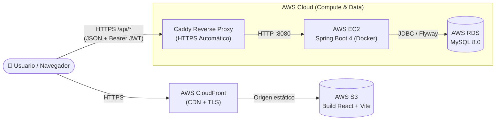

# Pasarela de Pagos P2P — Full Stack & Cloud

Aplicación full stack para gestionar usuarios, billeteras digitales y transferencias P2P por correo electrónico. Proyecto de portafolio enfocado en arquitectura limpia, seguridad stateless con JWT, contratos de API tipados y despliegue productivo en **AWS**.

> **Alcance del proyecto:** Demo técnica de portafolio desplegada en la nube. Modela transferencias internas entre usuarios en USD con dinero ficticio de prueba.

---

## Demo en Vivo y Repositorios

Este repositorio actúa como documentación central. El código fuente está desacoplado en dos repositorios independientes:

| Recurso | Enlace | Descripción |
|---|---|---|
| **App Web (Producción)** | [d4odp5kfk07rg.cloudfront.net](https://d4odp5kfk07rg.cloudfront.net) | Interfaz SPA servida desde AWS S3 + CloudFront |
| **API REST (Producción)** | [pasarela-pagos-api.duckdns.org](https://pasarela-pagos-api.duckdns.org) | Backend en AWS EC2 con proxy inverso Caddy HTTPS |
| **Swagger UI (OpenAPI)** | [pasarela-pagos-api.duckdns.org/swagger-ui.html](https://pasarela-pagos-api.duckdns.org/swagger-ui.html) | Documentación interactiva con soporte Bearer JWT |
| **Repo Backend** | [github.com/jro51/pasarela-pagos-backend](https://github.com/jro51/pasarela-pagos-backend) | API REST en Java 17 + Spring Boot 4 + Flyway |
| **Repo Frontend** | [github.com/jro51/pasarela-pagos-frontend](https://github.com/jro51/pasarela-pagos-frontend) | Cliente web en React 19 + TypeScript + Vite |

>  **Prueba rápida sin registro:** En la pantalla de `/login` de la demo pública encontrarás el botón **Probar demo**, precargado con una cuenta con saldo disponible para realizar transferencias al instante.

---

## Arquitectura Cloud (AWS)

El sistema separa el alojamiento estático del procesamiento transaccional para optimizar costos, latencia y seguridad:

### Aspectos clave de la infraestructura
* **Frontend (S3 + CloudFront):** La SPA compilada con Vite se aloja como archivos estáticos en S3 y se distribuye globalmente con HTTPS mediante CloudFront.
* **Backend (EC2 + Docker + Caddy):** La API corre contenerizada en una instancia EC2. **Caddy** gestiona automáticamente los certificados TLS/SSL (Let's Encrypt) sobre DuckDNS y redirige el tráfico hacia el contenedor de Spring Boot.
* **Base de Datos (AWS RDS):** Instancia administrada de MySQL 8.0 aislada en la nube, con esquema versionado exclusivamente mediante **Flyway**.

---

## Stack Tecnológico

| Capa | Tecnologías |
|---|---|
| **Frontend** | React 19, TypeScript, Vite, Tailwind CSS 4, React Router |
| **Backend** | Java 17, Spring Boot 4.0.8, Spring Web MVC, Spring Security, JWT (`jjwt`) |
| **Persistencia** | Spring Data JPA, Hibernate, MySQL 8, Flyway Migrations |
| **Cloud & DevOps** | AWS (EC2, RDS, S3, CloudFront), Docker, Docker Compose, Caddy |
| **QA & Docs** | JUnit 5, Mockito, MockMvc (54 tests), Springdoc OpenAPI / Swagger |

---

## Decisiones de Ingeniería Destacadas

* **Atomicidad y Precisión Financiera:** Las transferencias ejecutan el débito, crédito y registro de auditoría bajo `@Transactional` usando `BigDecimal` y columnas `DECIMAL(15,2)` para evitar errores de punto flotante.
* **Seguridad Stateless:** Autenticación mediante Bearer JWT sin sesiones en servidor. El usuario origen siempre se extrae del contexto de seguridad del token, nunca del cuerpo de la petición.
* **Manejo Uniforme de Errores:** Todas las excepciones de negocio, seguridad o validación devuelven un contrato JSON estandarizado (`code`, `message`, `fieldErrors`), permitiendo al frontend mapear errores directamente a los formularios.
* **Control de Consultas:** Uso de `spring.jpa.open-in-view=false` y `@EntityGraph` para prevenir problemas de consultas *N+1* y cargas perezosas fuera de la capa transaccional.

---

## Autor

Desarrollado por **[jro51](https://github.com/jro51)**.
